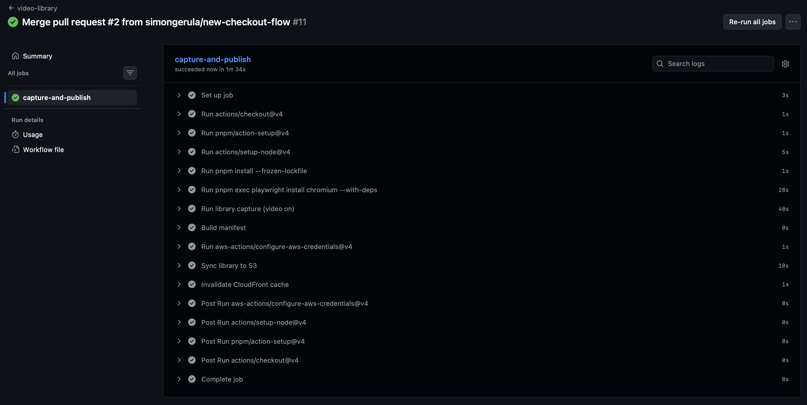
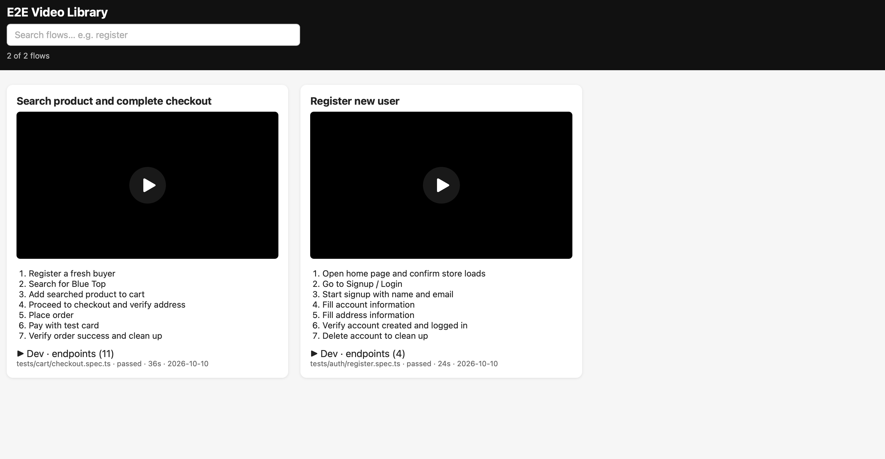

# E2E Video Library

> **Live demo:** https://d3882mw20sykae.cloudfront.net/viewer/index.html

Turn your Playwright end-to-end tests into a **searchable video knowledge base** for developers, QA, and product.

A new joiner types "register" or "checkout" → gets a real recorded video of that flow plus a step-by-step summary. No more digging through CI artifacts or asking "how is this flow supposed to look?".

## The problem

- Playwright already records videos, but they live inside CI run artifacts: hard to find, expired after days, and nobody browses them.
- When a flow changes, only the engineer who updated the test knows what it looks like now.
- Product people and new developers can't easily see or replicate a scenario.

## How it solves it

1. **Tests describe themselves.** Every test wraps user-visible actions in `await test.step('...')` (e.g. `Start signup with name and email`). These titles become the searchable, human-readable summary — no AI video analysis needed.
2. **A custom reporter captures everything.** `lib/video-reporter.ts` hooks into Playwright, collects the `test.step` titles plus the recorded video path per test, and writes one JSON per test.
3. **A manifest becomes the index.** `scripts/build-manifest.js` copies videos into `library/videos/` and merges everything into `library/manifest.json` (one entry per flow: title, steps, endpoints, video, date, commit). The manifest is plain JSON by design, so AI agents can fetch it and familiarize themselves with available flows and their context before acting.
4. **A static viewer makes it searchable.** `viewer/index.html` (no framework) loads the manifest, with a search box over titles + steps. Same file works locally and hosted.
5. **CI publishes on merge.** `.github/workflows/video-library.yml` runs only when `tests/**` changes: re-records with video on, rebuilds the manifest, syncs `library/` + `viewer/` to S3, and invalidates the CloudFront cache. Unchanged flows keep their existing videos (incremental, cheap). Future improvement: run only the modified spec files per merge (detect via `git diff`) instead of the whole suite — the manifest merge already supports it.

Planned next: AI summaries/tags via GitHub Copilot SDK, and a Slack post (`#e2e-demos`) every time a flow is published. See `PLAN.md` for the full design.

## It works end-to-end

Merging a PR that touches `tests/**` triggers `video-library`, which re-records, rebuilds the manifest, syncs to S3 and invalidates CloudFront:



The published library shows the video, `test.step` list and consumed endpoints per flow:



## What's needed to get it working

- **Node 22 + pnpm**, Playwright Chromium (`pnpm exec playwright install chromium`)
- **AWS**
  - S3 bucket (private) with prefixes `library/` and `viewer/`, e.g. `demo-video-library-simongerula` (`ap-southeast-2`), lifecycle rule expiring `library/videos/*` after 90 days
  - CloudFront distribution + Origin Access Control in front of the bucket, default root object `index.html`
  - IAM role for GitHub OIDC (`token.actions.githubusercontent.com`, audience `sts.amazonaws.com`) allowed to write `library/*`, `viewer/*`, `index.html` and invalidate the distribution — see `infra/`
- **GitHub secrets**: `AWS_ROLE_ARN`, `DISTRIBUTION_ID`
- **Demo site**: tests run against https://www.automationexercise.com (no account needed; tests create and delete their own users)

## Infrastructure setup (AWS)

One-time setup, ~20 minutes. Values below are this repo's; swap bucket/region/IDs for your own.

### 1. S3 bucket (private)

Create a **private** bucket with all public access blocked, e.g. `demo-video-library-simongerula` in `ap-southeast-2`. Versioning off. Expected layout (created by the sync commands, no need to hand-make prefixes):

```
s3://<bucket>/library/manifest.json
s3://<bucket>/library/videos/<test-id>.webm
s3://<bucket>/viewer/index.html
s3://<bucket>/index.html
```

```bash
aws s3 mb s3://demo-video-library-simongerula --region ap-southeast-2
```

Optional: lifecycle rule expiring old videos (see `PLAN-V2.md` §6 for the planned `latest/` + `releases/` layout with 30-day retention).

### 2. CloudFront + Origin Access Control

1. Create a CloudFront distribution with the bucket as origin via **Origin Access Control** (do not use public bucket + OAI).
2. Update the bucket policy to allow the distribution (console offers this as "copy policy" when you attach the OAC — apply it).
3. Set **Default root object** to `index.html` (repo root `index.html` redirects to `viewer/`).
4. Note the distribution ID (e.g. `E1B3GQRGKARZ6C`) and domain for the demo URL.

### 3. IAM role for GitHub OIDC (no long-lived keys)

1. Ensure the `token.actions.githubusercontent.com` OIDC provider exists in IAM (thumbprint managed by AWS).
2. Create role `e2e-video-uploader` (name it yours) with:
   - **Trust**: `infra/github-oidc-trust.json` — replace `<AWS_ACCOUNT_ID>` and confirm the `sub`. GitHub's `sub` now embeds numeric IDs (`repo:owner@ownerId/repo@repoId:*`); old `repo:OWNER/REPO:*` examples fail with `Not authorized to perform sts:AssumeRoleWithWebIdentity`. Decode the JWT claims once if assume-role is denied.
   - **Permissions**: `infra/s3-upload-policy.json` — `Put/Get/Delete` on `library/*`, `viewer/*`, `index.html`, `ListBucket`, plus `cloudfront:CreateInvalidation` on your distribution.

### 4. GitHub secrets

| Secret            | Value                                |
| ----------------- | ------------------------------------ |
| `AWS_ROLE_ARN`    | `arn:aws:iam::<account>:role/<role>` |
| `DISTRIBUTION_ID` | your CloudFront distribution ID      |

### 5. First deploy + verify

```bash
pnpm run test:library          # capture (tests/functional, video on)
pnpm run build:manifest        # merge into library/manifest.json
aws s3 sync library/ "s3://<bucket>/library/" --delete
aws s3 sync viewer/ "s3://<bucket>/viewer/" --delete
aws s3 cp index.html "s3://<bucket>/index.html" --content-type "text/html"
aws cloudfront create-invalidation --distribution-id <id> --paths "/*"
```

Open `https://<distribution-domain>/viewer/index.html` — you should see the clips with video, steps, and endpoints. Afterwards, publishing is the manual `video-library` workflow (merge pipeline itself runs only `tests/e2e` via `e2e.yml`).

## Quickstart

```bash
pnpm install
pnpm exec playwright install chromium

# normal test run (video only kept on failure)
pnpm test

# library capture (always records video + writes reporter JSON)
pnpm run test:library
pnpm run build:manifest

# browse locally (must be over http, not file://)
npx serve .
# open /viewer/ and search, e.g. "register"
```

## Repo map

| Path                                  | What it is                                                                                                    |
| ------------------------------------- | ------------------------------------------------------------------------------------------------------------- |
| `tests/auth/register.spec.ts`         | Example flow: register → verify → delete (all steps in `test.step`)                                           |
| `lib/video-reporter.ts`               | Reusable Playwright reporter (options-only, no hardcodes) → `test-results/video-meta/*.json`                  |
| `scripts/build-manifest.js`           | Pure CLI (`--results/--out/--videos`) → `library/manifest.json`, videos named `library/videos/<test-id>.webm` |
| `viewer/index.html`                   | Static search + video page, reads `../library/manifest.json`                                                  |
| `index.html`                          | Root redirect to `viewer/` (also CloudFront's default root object)                                            |
| `.github/workflows/video-library.yml` | Merge pipeline: capture → manifest → S3 sync → CloudFront invalidation                                        |
| `infra/`                              | OIDC trust + S3 upload policies (versioned reference; create the role via IAM console)                        |
| `PLAN.md`                             | Full architecture, S3/CloudFront notes, OIDC gotchas, roadmap                                                 |

## Gotchas worth knowing

- GitHub's OIDC `sub` now embeds numeric IDs (`repo:owner@ownerId/repo@repoId:...`) — old `repo:OWNER/REPO:*` trust examples fail. Decode the token claims if assume-role is denied.
